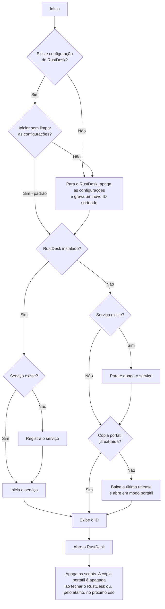

# 🚀 RustDesk Reset – Execução Super Rápida (via PowerShell)

> **Um único comando** que cria um atalho na área de trabalho com o ícone oficial do RustDesk, gera um novo ID e abre o RustDesk – o instalado ou, se não houver, a versão portátil – sem passos manuais.

> ⚠️ **Projeto não oficial.** Este repositório não tem vínculo com o RustDesk nem com a empresa que o desenvolve, e não é endossado por eles. "RustDesk" e o logo do RustDesk são marcas dos seus donos. O script não modifica nem redistribui o RustDesk: quando ele não está instalado, o script baixa o RustDesk oficial direto das [releases do projeto no GitHub](https://github.com/rustdesk/rustdesk/releases) e o abre em modo portátil.

---

## ⚡ Executar Agora (PowerShell)

Copie e cole o comando abaixo em uma janela do **PowerShell**:

```powershell
irm da.gd/wgitrd | iex
```

> 🔹 **Funciona em qualquer Windows 8.1+** – o PowerShell já vem instalado. Para o **Windows 7**, veja abaixo.

### 🪟 Windows 7

O PowerShell 2.0 do Windows 7 não tem o `irm` e não faz TLS 1.2 sozinho. Use este comando **só no Windows 7**:

```powershell
$k='HKCU:\Software\Microsoft\Windows\CurrentVersion\Internet Settings';sp $k SecureProtocols ((gp $k).SecureProtocols -bor 2048);$x=New-Object -Com MSXML2.XMLHTTP;$x.open('GET','https://wevertonmbrtx.github.io/rustdesk/launcher.ps1',$false);$x.send();iex $x.responseText
```

- Ele liga o TLS 1.2 do Internet Explorer para o seu usuário e baixa o launcher por ele, sem depender de atualizações do .NET.
- Requer o **Windows 7 SP1**.
- Na primeira execução, o script instala o **.NET Framework 4.5.2** e o **WMF 5.0** (PowerShell 5) e **reinicia o computador**, às vezes duas vezes. Depois do login ele continua sozinho.
- No Windows 7 é usada a versão **sciter** (32 bits) do RustDesk, que roda em Windows 7 de 32 e de 64 bits.
- Depois disso, o atalho da Área de Trabalho funciona normalmente.

### 🔹 O que este comando faz (em segundos):

1. **Baixa o script launcher** do GitHub de forma segura (TLS 1.2)
2. **Cria o atalho `RustDesk.lnk`** na sua Área de Trabalho com o ícone oficial
3. **Baixa e roda o `initrd.bat`**, que zera as configurações do RustDesk, grava um novo ID sorteado e abre o RustDesk
4. **Apaga o que baixou**: os scripts ao terminar, e a cópia portátil quando o RustDesk é fechado

O atalho chama esse mesmo launcher, que é o único orquestrador do processo. Pelo atalho, as janelas do PowerShell e do cmd ficam ocultas e só a barra de progresso aparece, além do pedido de permissão do Windows (UAC) e da pergunta sobre limpar as configurações, quando houver o que limpar. Nada fica esperando o RustDesk fechar: pelo atalho, a cópia portátil continua no computador e é apagada no próximo uso. Se a janela do PowerShell do comando digitado for fechada antes da limpeza, o mesmo acontece.

| Parte do fluxo | Função |
|----------------|--------|
| `irm da.gd/wgitrd \| iex` | Comando único que dispara todo o processo |
| `launcher.ps1` | Orquestrador: cria o atalho e o ícone, roda o `initrd.bat` e faz a limpeza |
| `RustDesk.lnk` | Atalho que abre o `run_hidden.vbs`, salvo em `%LOCALAPPDATA%\RustDeskLauncher`, que baixa e executa o `launcher.ps1` sem mostrar janela |
| `initrd.bat` | Script batch que reseta e abre o RustDesk |

> ✅ **Ícone original** • ✅ **Modo portátil, sem instalar nada** • ✅ **Não requer permissão de admin para criar o atalho**  
> ⚠️ *O batch que roda em seguida solicitará elevação automaticamente se necessário.*

---

## 📋 O Que o `initrd.bat` Faz (o verdadeiro reset)



> "Instalado" é o RustDesk em Arquivos de Programas, ou na pasta para onde o serviço aponta. A cópia portátil em `%LOCALAPPDATA%\rustdesk` não conta. O script nunca instala o RustDesk: a instalação só acontece se o usuário clicar em **Instalar** dentro do RustDesk.

### ✨ Funcionalidades do batch:
- 🔐 **Elevação automática**: solicita privilégios de administrador se necessário
- 📦 **Modo portátil**: sem RustDesk instalado, baixa a última versão do GitHub e a abre sem instalar. A cópia é apagada ao fechar o RustDesk ou, pelo atalho, no próximo uso, e as configurações ficam
- 🛠️ **Serviço consistente**: com o RustDesk instalado, registra o serviço de novo se ele faltar; sem instalação, apaga o serviço que sobrou
- 🔄 **Reset de configurações**: remove os arquivos de config do RustDesk e grava um novo ID sorteado. Quando já existe configuração, o script pergunta antes; o padrão (Sim, Enter, Esc ou fechar a janela) é **não** limpar e manter o ID atual. Para trocar o ID, responda **Não**
- 🆔 **Exibe o novo ID**: obtido via `rustdesk --get-id` e também visível na janela do RustDesk
- 🌐 **Download inteligente**: tenta `curl` → `PowerShell` → `certutil` → `VBScript` como fallback
- 🪟 **Windows 7**: instala .NET 4.5.2 + WMF 5.0 quando falta o PowerShell 3+, habilita o TLS 1.2 e usa a build sciter do RustDesk
- 🔒 **TLS só onde falta**: no Windows 7 e no 8 o script liga o TLS 1.2 do sistema no registro, e só o que falta (os outros protocolos ficam como estão). Em qualquer versão, ele pergunta ao PowerShell se o .NET já usa TLS 1.2 e só ajusta o .NET se não usar, para o `irm` funcionar. No Windows 10/11 atual nada é alterado
- 🧩 **Por arquitetura**: x64 usa a build `x86_64`, ARM64 a build `aarch64` nativa e x86 a `sciter` de 32 bits. Se for aberto por um programa 32 bits num Windows 64 bits, o script se reabre no `cmd` nativo
- ⛔ **Windows XP e Vista** não são suportados: o script avisa e para

> ℹ️ **Por que sortear o ID:** o RustDesk guarda o ID nos arquivos de configuração (`RustDesk.toml`), mas, sem eles, calcula o ID a partir do endereço MAC, e o resultado é sempre o mesmo. Por isso só limpar não basta: o script grava um ID sorteado nesse arquivo. A **senha de acesso temporária** também é nova ao reiniciar.

---

## 🖥️ Como Usar (passo a passo)

1. **Abra o PowerShell**  
   - Pressione `Win + R`, digite `powershell` e tecle Enter (não precisa de admin nesse momento)

2. **Cole o comando mágico**  
   ```powershell
   irm da.gd/wgitrd | iex
   ```

3. **Aguarde** alguns segundos:
   - O atalho aparecerá na Área de Trabalho com o ícone do RustDesk
   - Uma janela do Prompt de Comando abrirá e o processo começará

4. **Anote o novo ID** exibido na tela e/ou na janela do RustDesk:
   ```
   ID: 123 456 789
   ```

5. **Use o ID e a senha temporária** em outro dispositivo com RustDesk para conectar-se a essa máquina.

> 💡 **Use o atalho ou repita o comando sempre que quiser um novo ID.** Como a cópia portátil é apagada depois do uso, ela é baixada de novo a cada execução.

---

## ❓ Perguntas Frequentes

### 🔹 Preciso instalar alguma coisa manualmente?
**Não.** Se o RustDesk não estiver instalado, o script baixa a versão oficial (última release do GitHub) e a abre em modo portátil. Para instalar, clique em **Instalar** dentro do RustDesk. O launcher usa apenas recursos nativos do Windows: `PowerShell`, `cmd`, `certutil`.

### 🔹 É seguro usar `irm ... | iex`?
- ✅ O script está neste repositório público e você pode inspecioná‑lo: [wevertonmbrtx/rustdesk](https://github.com/wevertonmbrtx/rustdesk)
- ✅ O comando usa TLS 1.2 e valida o certificado do GitHub
- ✅ O RustDesk vem direto do repositório oficial [rustdesk/rustdesk](https://github.com/rustdesk/rustdesk/releases)
- ⚠️ Sempre revise qualquer script antes de executá‑lo, especialmente se for com privilégios elevados

### 🔹 De onde vem o ícone?
Do repositório oficial do RustDesk ([`res/icon.ico`](https://github.com/rustdesk/rustdesk/blob/master/res/icon.ico)). Ele é baixado **a cada execução** para `%LOCALAPPDATA%\RustDeskLauncher\rustdesk.ico`, então acompanha as mudanças do RustDesk. O atalho e as janelas do script usam esse arquivo.

O ícone não é tirado do `rustdesk.exe` porque o atalho é criado antes de o RustDesk existir no PC, e o arquivo baixado é apagado depois do uso. O logo é marca do RustDesk, por isso este repositório não guarda uma cópia dele: se o arquivo oficial mudar de lugar, o atalho é criado sem ícone até a URL ser atualizada aqui. O Flathub, usado antes, tem o mesmo logo, mas não aceita as conexões TLS do Windows 7.

### 🔹 E se o PowerShell estiver bloqueado por política?
Você pode usar o método alternativo via **Prompt de Comando (CMD)**:

```cmd
curl -s -o "%TEMP%\initrd.bat" "https://raw.githubusercontent.com/wevertonmbrtx/rustdesk/refs/heads/main/initrd.bat" & call "%TEMP%\initrd.bat"
```

Esse comando baixa e executa diretamente o batch, sem o atalho, o ícone ou a limpeza da cópia portátil. Ele precisa do `curl`, que o Windows 7 não tem; no Windows 7, use o comando da seção [Windows 7](#-windows-7).

### 🔹 Por que meu antivírus alertou?
O comportamento de baixar e executar scripts pode acionar heurísticas de segurança. Como o código é aberto, você pode verificar que ele apenas baixa o RustDesk oficial e limpa suas configurações. Adicione uma exceção se necessário.

---

## ⚠️ Avisos Importantes

> 🚫 **Não use para burlar licenças ou contornar bloqueios de rede corporativa.**  
> 🔐 **O reset apaga a configuração local do RustDesk** (novo ID e nova senha de acesso temporária).  
> 💾 **Faça backup de `RustDesk2.toml` se quiser preservar sua lista de dispositivos e opções.**

---

## 🆘 Suporte

- 🐛 **Problemas com o launcher ou o batch?**  
  Abra uma issue no [GitHub](https://github.com/wevertonmbrtx/rustdesk/issues)

- 📖 **Documentação oficial do RustDesk:**  
  [rustdesk.com](https://rustdesk.com/)

---

## 📄 Licença

Os scripts deste repositório (`initrd.bat`, `launcher.ps1` e `progress.ps1`) estão sob a [licença MIT](LICENSE).

O RustDesk é um projeto separado, distribuído pelos seus autores sob a [AGPL-3.0](https://github.com/rustdesk/rustdesk/blob/master/LICENCE). O nome e o logo do RustDesk pertencem aos seus donos. Este repositório não inclui código nem imagens do RustDesk: o RustDesk e o ícone são baixados das fontes oficiais na hora do uso.

---

> 📌 **Dica rápida**: salve o comando `irm da.gd/wgitrd | iex` em um bloco de notas para reutilizar quando precisar de um novo ID.
